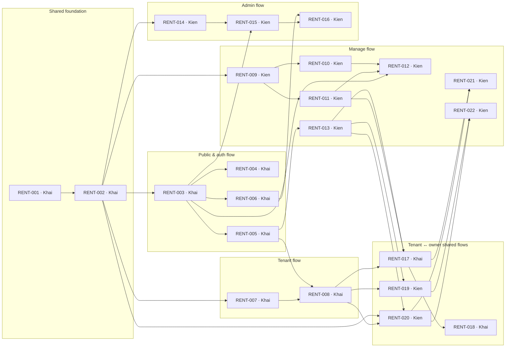

# rentOS issue plan

Backlog for **Khai** and **Kien**, grouped by the actor flows of the [prototype](https://claude.ai/artifact/1E8CD1qFNEJRpUSVJ4kAqU): public & auth (S01–S09), tenant (T01–T09), manage/owner (M01–M15) and admin (A01–A06). Flows that cross the tenant and owner workspaces are their own issues: the contract flow (F3 + F4), deadline expiry (F5), withdraw/reject (F8) and renewal (F6).

Issue bodies live in `issues/<flow>/RENT-xxx-*.md`, `issues-manifest.json` holds the same data for publishing, `coverage-validation.md` shows which requirements are planned or intentionally dropped, and `repository-audit.md` records the starting point.

## Ownership
| Flow | Owner | Issues |
|---|---|---|
| Shared foundation | Khai | Setup and server access helpers, database schema and seed |
| Public & auth flow (S01–S09) | Khai | Search and detail, favourites, rental request, reporting a listing |
| Tenant flow (T01–T09) | Khai | Account/profile/notifications, tenant home and requests |
| Manage flow (M01–M15) | Kien | Properties, units, photos, listings, request inbox, end/cancel, overview |
| Admin flow (A01–A06) | Kien | Dashboard and first review, suspension, report investigation |
| Contract flow (F3 + F4) and deadline expiry (F5) | Khai | Proposal, confirm, decline, revise, move-in; lazy hold expiry |
| Withdraw/reject (F8) and renewal (F6) | Kien | Request withdraw/reject/15-day auto-reject; renewal request to confirmed extension |

Each member reviews the other's PRs. Khai writes all migrations; Kien asks for schema changes in the issue or in review.

## Simplifications from the copied docs
The docs (trimmed to match this plan; dropped requirements are marked `Removed`) come from another course. This plan keeps the product rules and drops that course's infrastructure:
- **Synchronous processing.** Actions insert notifications directly in their own transaction. No outbox, worker or scheduler.
- **Time-based rules run lazily.** Expired 48-hour holds and 15-day-old requests are handled when someone opens or acts on the record.
- **Fallback without a worker.** If something must run on its own (holds nobody opens, emails), Supabase Cron (`pg_cron` + `pg_net`) or a Supabase Database Webhook POSTs to a protected Route Handler in the same Next.js app (`/api/cron/*`, `/api/webhooks/*`) that calls the same server function. No separate worker is deployed.
- **Supabase sessions + Server Actions.** `getClaims()` verifies the session; Server Actions bring their own same-origin (CSRF) check. No custom JWT/JWKS code or REST API layer.
- **Database constraints instead of idempotency keys and lock-order rules.** Unique and overlap constraints stop duplicates and double-booking.
- **No audit log, logging/alerts, monitoring, caching, OpenAPI or course submission work.**

## Working rules
- Branch `feat/rent-xxx-slug` from `develop`; PR into `develop` with `Closes #n`; follow `.github/PULL_REQUEST_TEMPLATE.md`.
- While a dependency is in progress, build against seed data, then connect to the real feature when it merges.
- Estimates are tentative.
- Out of scope: product P2/P3 items (Google login, maps, geocoding, property reviews, changes-requested state).

## Publishing to GitHub
1. Create labels (`flow:*`, `module:*`, `priority:*`, `risk:*`, `area:*`) and one milestone per flow.
2. Create issues in manifest order with `gh issue create --body-file planning/issues/<file>`. Each body starts with `<!-- rentos-task: RENT-xxx -->`; search for it first to avoid duplicates.
3. Write numbers/URLs back into `issues-manifest.json`, then replace `RENT-xxx` dependency keys with `#numbers`.
4. Assign Khai as `DangCongKhai` and Kien as `ndrhmdk`.

## Flows at a glance

| Flow | Folder | Issues | Khai | Kien | Scope |
|---|---|---|---|---|---|
| Shared foundation | `issues/00-shared-foundation/` | RENT-001, RENT-002 | 3.5d | 0d | Project setup and the database every flow builds on. |
| Public & auth flow | `issues/01-public-auth-flow/` | RENT-003, RENT-004, RENT-005, RENT-006 | 7d | 0d | Prototype page 03, screens S01–S09, flow F1 and the report side of F7. |
| Tenant flow | `issues/02-tenant-flow/` | RENT-007, RENT-008 | 3d | 0d | Prototype page 04, screens T01–T03, T07, T08. |
| Manage flow | `issues/03-manage-flow/` | RENT-009, RENT-010, RENT-011, RENT-012, RENT-013, RENT-021, RENT-022 | 0d | 10d | Prototype page 05, screens M01–M11 and M13 owner-only actions, flow F2. |
| Admin flow | `issues/04-admin-flow/` | RENT-014, RENT-015, RENT-016 | 0d | 4.5d | Prototype page 06, screens A01–A06, flows F2 (review) and F7 (suspension). |
| Tenant ↔ owner shared flows | `issues/05-tenant-owner-shared-flows/` | RENT-017, RENT-018, RENT-019, RENT-020 | 5.5d | 4d | Flows that cross both workspaces: contract (F3 + F4), deadline expiry (F5), withdraw/reject (F8), renewal (F6). |

## Shared foundation · Everyone

Project setup and the database every flow builds on.

| ID | Issue | Owner | Reviewer | Est. | Depends on |
|---|---|---|---|---|---|
| RENT-001 | [Project setup: CI, test runner and server access helpers](issues/00-shared-foundation/RENT-001-project-setup-ci-server-helpers.md) | Khai | Kien | 1 day | — |
| RENT-002 | [Database schema, integrity constraints, notifications helper and seed data](issues/00-shared-foundation/RENT-002-database-schema-seed.md) | Khai | Kien | 2.5 days | RENT-001 |

## Public & auth flow · Guest / signed-in user

Prototype page 03, screens S01–S09, flow F1 and the report side of F7.

| ID | Issue | Owner | Reviewer | Est. | Depends on |
|---|---|---|---|---|---|
| RENT-003 | [Browse, search by dates and view listing details (S01, S02, S03, S08, S09)](issues/01-public-auth-flow/RENT-003-browse-search-listing-detail.md) | Khai | Kien | 3 days | RENT-002 |
| RENT-004 | [Save favourite properties from cards and details (S02 sidebar)](issues/01-public-auth-flow/RENT-004-favourite-properties.md) | Khai | Kien | 1.5 days | RENT-003 |
| RENT-005 | [Send a rental request from a listing (S03 → S06 → S04)](issues/01-public-auth-flow/RENT-005-send-rental-request.md) | Khai | Kien | 1.5 days | RENT-003 |
| RENT-006 | [Report a listing and follow the outcome (S05, T09)](issues/01-public-auth-flow/RENT-006-report-listing-track-outcome.md) | Khai | Kien | 1 day | RENT-003 |

## Tenant flow · Tenant

Prototype page 04, screens T01–T03, T07, T08.

| ID | Issue | Owner | Reviewer | Est. | Depends on |
|---|---|---|---|---|---|
| RENT-007 | [Account: sign-in hardening, profile and notifications (S06, T07, T08)](issues/02-tenant-flow/RENT-007-account-auth-profile-notifications.md) | Khai | Kien | 1.5 days | RENT-002 |
| RENT-008 | [Tenant home and rental request tracking (T01, T02, T03)](issues/02-tenant-flow/RENT-008-tenant-home-rental-requests.md) | Khai | Kien | 1.5 days | RENT-005, RENT-007 |

## Manage flow · Owner

Prototype page 05, screens M01–M11 and M13 owner-only actions, flow F2.

| ID | Issue | Owner | Reviewer | Est. | Depends on |
|---|---|---|---|---|---|
| RENT-009 | [Owner manages properties with the 5-step wizard (M02, M03)](issues/03-manage-flow/RENT-009-manage-properties-wizard.md) | Kien | Khai | 2 days | RENT-002 |
| RENT-010 | [Owner creates units in bulk and edits each unit (M04, M05)](issues/03-manage-flow/RENT-010-manage-units-bulk-create.md) | Kien | Khai | 1.5 days | RENT-009 |
| RENT-011 | [Owner uploads and manages property and unit photos with Supabase Storage (M06)](issues/03-manage-flow/RENT-011-manage-photos-supabase-storage.md) | Kien | Khai | 1.5 days | RENT-009 |
| RENT-012 | [Owner builds the listing, submits it for review and publishes it (M07, M08/M09)](issues/03-manage-flow/RENT-012-manage-listings-submit-publish.md) | Kien | Khai | 2 days | RENT-010, RENT-011, RENT-003 |
| RENT-013 | [Owner rental request inbox (M10, M11)](issues/03-manage-flow/RENT-013-manage-request-inbox.md) | Kien | Khai | 1 day | RENT-005 |
| RENT-021 | [Owner ends or cancels a tenancy (M13 actions)](issues/03-manage-flow/RENT-021-manage-end-cancel-tenancy.md) | Kien | Khai | 1 day | RENT-017, RENT-020 |
| RENT-022 | [Owner overview dashboard (M01)](issues/03-manage-flow/RENT-022-manage-overview-dashboard.md) | Kien | Khai | 1 day | RENT-019, RENT-020 |

## Admin flow · Admin

Prototype page 06, screens A01–A06, flows F2 (review) and F7 (suspension).

| ID | Issue | Owner | Reviewer | Est. | Depends on |
|---|---|---|---|---|---|
| RENT-014 | [Admin dashboard and first review of listing packages (A01, A02, A03)](issues/04-admin-flow/RENT-014-admin-dashboard-first-review.md) | Kien | Khai | 2 days | RENT-002 |
| | ↳ Build against seeded PENDING listings; connect to real submissions once RENT-012 merges. | | | | |
| RENT-015 | [Admin manages listings and suspends or restores them (A06)](issues/04-admin-flow/RENT-015-admin-listing-suspension.md) | Kien | Khai | 1 day | RENT-014, RENT-003 |
| RENT-016 | [Admin investigates reports and resolves, dismisses or suspends (A04, A05)](issues/04-admin-flow/RENT-016-admin-report-investigation.md) | Kien | Khai | 1.5 days | RENT-006, RENT-015 |

## Tenant ↔ owner shared flows · Tenant + owner

Flows that cross both workspaces: contract (F3 + F4), deadline expiry (F5), withdraw/reject (F8), renewal (F6).

| ID | Issue | Owner | Reviewer | Est. | Depends on |
|---|---|---|---|---|---|
| RENT-017 | [Contract flow: proposal, confirmation, decline, revision and move-in (F3 + F4)](issues/05-tenant-owner-shared-flows/RENT-017-contract-proposal-decline-revise.md) | Khai | Kien | 4.5 days | RENT-013, RENT-008, RENT-011 |
| RENT-018 | [Confirmation deadline expiry without background jobs (F5)](issues/05-tenant-owner-shared-flows/RENT-018-confirmation-deadline-expiry.md) | Khai | Kien | 1 day | RENT-017 |
| RENT-019 | [F8 · Tenant withdraws, owner rejects, and 15-day-old requests auto-reject (T02, T03, M11)](issues/05-tenant-owner-shared-flows/RENT-019-withdraw-reject-auto-reject-requests.md) | Kien | Khai | 1.5 days | RENT-008, RENT-013 |
| | ↳ Withdraw, reject and auto-reject do not need contracts. Only the “withdraw at the same moment a proposal is created” test waits for RENT-017; add it when that merges. | | | | |
| RENT-020 | [F6 · Tenancy renewal from request to confirmed extension (T05, T06, M15, T04)](issues/05-tenant-owner-shared-flows/RENT-020-tenancy-renewal.md) | Kien | Khai | 2.5 days | RENT-002, RENT-008, RENT-013 |
| | ↳ Build request, withdraw, reject and propose against the seeded CONFIRMED tenancies. Only the final step (tenant confirms the renewal via `confirmContract`) waits for RENT-017. | | | | |

## Suggested build order

Topological order of the dependency graph. Each member picks their next unblocked issue from their own column.

| Step | Khai | Kien |
|---|---|---|
| 1 | RENT-001 | — |
| 2 | RENT-002 | — |
| 3 | RENT-003, RENT-007 | RENT-009, RENT-014 |
| 4 | RENT-004, RENT-005, RENT-006 | RENT-010, RENT-011, RENT-015 |
| 5 | RENT-008 | RENT-012, RENT-013, RENT-016 |
| 6 | RENT-017 | RENT-019, RENT-020 |
| 7 | RENT-018 | RENT-021, RENT-022 |

## Dependency graph

